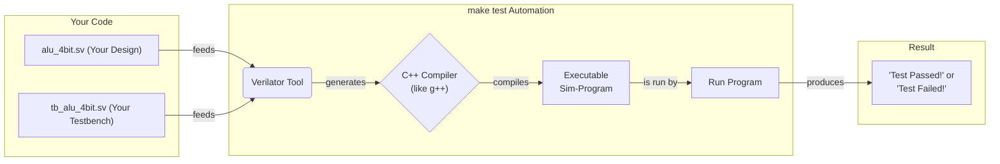

# Day 02 Completed: SystemVerilog Combinational Circuits

This is the completed project for designing combinational circuits in SystemVerilog.

---

🌐 Available languages:
[English](./README.md) | [日本語](./README_ja.md)

## Lesson at a glance

The reference solution already implements the tasks below.

| Item | Details |
| --- | --- |
| Where to edit | Arithmetic TODOs in alu_4bit.sv |
| Provided foundation | top_9k.sv / top_20k.sv provide a blinking-LED circuit |
| Expected test results | `make test` checks arithmetic and logic results |
| What to observe on hardware | LED blinks about four times faster than Day01. ALU results are not connected to LEDs |

## File Structure

- `alu_4bit.sv` - 4-bit ALU
- `tb_alu_4bit.sv` - ALU testbench
- `Makefile` - Build and test automation

## Implemented Modules

### 1. 4-bit ALU

- Four types of operations: Addition, Subtraction, AND, OR
- Flag outputs: Zero, Carry
- Zero detection and a carry output indicating carry/borrow

## How to Build and Test

### Simulation Test

```bash
make test
```

### FPGA Build

```bash
# Tang Nano 9K
make BOARD=9k download

# Tang Nano 20K
make BOARD=20k download
```

## Test Contents

The ALU testbench tests the following:

1. Basic addition (5 + 3 = 8)
2. Overflow (15 + 1 = 0, carry=1)
3. Basic subtraction (8 - 3 = 5)
4. Zero result (5 - 5 = 0, zero=1)
5. AND operation (12 & 10 = 8)
6. OR operation (12 | 10 = 14)

## 🧪 What is a Testbench? (A "Unit Test" for Hardware)

A **testbench** is a SystemVerilog module that exists **only for simulation**. Its job is to "wrap around" your design (the "Design Under Test" or DUT), feed it inputs, and check if the outputs are correct. This code is **never synthesized** into an actual FPGA circuit.

A testbench typically does three things:

1. **Instantiate the DUT**: Create an instance of the module you want to test (e.g., `alu_4bit`).
2. **Provide Stimulus**: Drive the input ports of your DUT with various values. The `#10` is a simulation-only delay to give the circuit time to react.
3. **Check Results**: Use `assert` to verify that the DUT's outputs match expected values.

## 🔬 What is Verilator? (The Hardware "Transpiler")

**Verilator** is a tool that analyzes SystemVerilog and generates a C++ simulation model. While this model verifies the logical behavior of your RTL, it does not reproduce analog characteristics, actual device delays, or post-place-and-route timing. When that C++ code is compiled and executed, it displays your test results.

The `make test` command automates this entire flow:



## Inspect Waveforms with Surfer

### 1. Install the viewer

This curriculum uses [Surfer](https://surfer-project.org/) on macOS, Windows, and Linux. It opens the VCD files generated by Verilator directly.

- **macOS**: Run `brew install surfer` (see the [Homebrew formula](https://formulae.brew.sh/formula/surfer)).
- **Windows**: Download and extract the archive using the Windows link on the [official website](https://surfer-project.org/). These examples place the executable at `C:\Tools\Surfer\surfer.exe`. Run Verilator in WSL and use the Windows version of Surfer to view waveforms.
- **Linux**: Install a pre-built binary or your distribution's package following the [official installation instructions](https://docs.surfer-project.org/book/).

### 2. Generate and open the VCD

Run these commands in the directory containing this README. The supplied `tb_alu_4bit.sv` already includes `$dumpfile` and `$dumpvars`, and the Makefile enables `--trace`.

```bash
make test

# macOS / Linux
make wave
# Alternatively, open the same file directly
surfer ./tb_alu_4bit.vcd
```

**Windows / WSL**: After `make test`, run the following in WSL. `wslpath` converts the absolute VCD path into a Windows path.

```bash
/mnt/c/Tools/Surfer/surfer.exe "$(wslpath -w "$PWD/tb_alu_4bit.vcd")"
```

To open it from PowerShell, supply a VCD path accessible from Windows:

```powershell
& C:\Tools\Surfer\surfer.exe 'C:\path\to\tb_alu_4bit.vcd'
```

`make wave` opens an existing VCD. After changing the RTL or testbench, run `make test` again first. To use another viewer command, set `make wave WAVE_VIEWER=/path/to/surfer`. When launching the Windows viewer from WSL, use the path-converting command above.

### 3. Add signals and inspect results

Expand the `tb_alu_4bit` hierarchy in Surfer and add `a`, `b`, `op`, `result`, `zero`, and `carry` to the waveform display. Zoom to fit the full trace, then move the cursor to each test interval to inspect values.

- `5 + 3`: `result = 8`, `zero = 0`, `carry = 0`
- `15 + 1`: the 4-bit result is `0`, with `zero = 1` and `carry = 1`
- `5 - 5`: `result = 0`, `zero = 1`

If signals are missing, check the hierarchy and add them to the display. If values are stale, regenerate the VCD with `make test` and reopen it.

## Learning Points

### SystemVerilog Syntax

- Combinational circuits using `always_comb`
- Conditional branching using `case` statements
- Specifying bit widths and carry calculation
- Testing with assertions (`assert`)

### Design Methods

- Modular design and interface definition
- Functional verification with testbenches
- Hierarchical circuit structure

### Debugging Techniques

- Verifying operation with simulation
- Signal analysis with waveforms
- Identifying problems from error messages

## Advanced Assignments

1. **BCD Decoder**: Implement a decoder for Binary Coded Decimal
2. **Priority Encoder**: Output the position of the most significant '1' bit
3. **Parity Generator**: Calculate even/odd parity

These basic modules will be important building blocks in the later CPU design.

The supplied board tops only blink an LED to confirm programming. The ALU is not connected to them; validate ALU arithmetic with `make test`. Hardware ALU integration requires additional input/output wiring and is an optional exercise.
