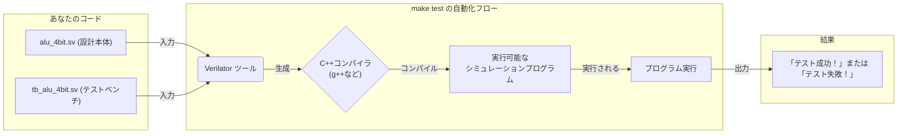

# Day 02 Completed: SystemVerilog Combinational Circuits

SystemVerilog の組み合わせ回路設計の完成版プロジェクトです。

## 実習の見取り図

完成例では下記の課題が実装済みです。

| 項目               | 内容                                            |
| ------------------ | ----------------------------------------------- |
| 編集する箇所       | alu_4bit.sv の演算処理の TODO                   |
| 用意されているもの | top_9k.sv / top_20k.svは点滅確認回路            |
| テストの期待値     | `make test` で加減算・論理演算の期待値          |
| 実機で見るもの     | LEDがDay01の約4倍速で点滅。ALU結果はLEDに未接続 |

## ファイル構成

- `alu_4bit.sv` - 4bit ALU
- `tb_alu_4bit.sv` - ALU テストベンチ
- `Makefile` - ビルド・テスト自動化

## 実装モジュール

### 1. 4bit ALU

- 4 種類の演算: 加算、減算、AND、OR
- フラグ出力: Zero、Carry
- ゼロ判定と桁上がり/ボローを示す carry 出力

## ビルド方法

### シミュレーションテスト

```bash
make test
```

### FPGAビルド

```bash
# Tang Nano 9K
make BOARD=9k download

# Tang Nano 20K
make BOARD=20k download
```

## テスト内容

ALU テストベンチで以下をテスト:

1. 基本加算 (5 + 3 = 8)
2. オーバーフロー (15 + 1 = 0, carry=1)
3. 基本減算 (8 - 3 = 5)
4. ゼロ結果 (5 - 5 = 0, zero=1)
5. AND 演算 (12 & 10 = 8)
6. OR 演算 (12 | 10 = 14)

## 🧪 テストベンチとは？ (ハードウェアの「ユニットテスト」)

**テストベンチ**は、**シミュレーションのためだけ**に存在する SystemVerilog モジュールです。その役割は、あなたが設計した回路（"Design Under Test" or DUT）を「包み込み」、入力を与え、出力が正しいかを確認することです。このコードが FPGA チップ上の実際の回路になる（**合成される**）ことはありません。

テストベンチは、通常 3 つのことを行います。

1. **DUTをインスタンス化する**: テストしたいモジュール（例: `alu_4bit`）のインスタンスを作成します。
2. **刺激 (Stimulus) を与える**: DUT の入力ポートに様々な値を設定します。`#10` はシミュレーション専用の遅延で、回路が反応する時間を与えます。
3. **結果をチェックする**: `assert` を使い、DUT の出力が期待値と一致するかを検証します。

## 🔬 Verilatorとは？ (ハードウェアの「トランスパイラ」)

Verilator は SystemVerilog を解析して C++モデルを生成し、シミュレーションするツールです。モデルは RTL の論理動作を検証しますが、アナログ特性・実デバイス遅延・配置配線後の挙動までは再現しません。その C++コードをコンパイルして実行すると、テスト結果が表示されます。

`make test` コマンドは、この一連の流れをすべて自動化します。



## Surferで波形を確認する

### 1. ビューアを準備する

この教材では、macOS・Windows・Linux共通の波形ビューアとして[Surfer](https://surfer-project.org/)を使用します。Verilatorが生成するVCDをそのまま開けます。

- **macOS**: `brew install surfer` でインストールします（[Homebrewの配布情報](https://formulae.brew.sh/formula/surfer)）。
- **Windows**: [公式サイト](https://surfer-project.org/)のWindowsリンクから配布ファイルを取得・展開し、ここでは `C:\Tools\Surfer\surfer.exe` に配置します。シミュレーションにはWSLのVerilatorを使い、波形表示にはWindows版Surferを使います。
- **Linux**: [公式インストール手順](https://docs.surfer-project.org/book/)に従って、配布バイナリまたはディストリビューションのパッケージを導入します。

### 2. VCDを生成して開く

このREADMEのあるディレクトリで実行します。付属の `tb_alu_4bit.sv` には `$dumpfile` と `$dumpvars` があり、Makefileも `--trace` を指定済みです。

```bash
make test

# macOS / Linux
make wave
# 同じファイルを直接開く場合
surfer ./tb_alu_4bit.vcd
```

**Windows / WSL**では、`make test` の後にWSLから次を実行します。`wslpath` でVCDの絶対パスをWindows形式へ変換します。

```bash
/mnt/c/Tools/Surfer/surfer.exe "$(wslpath -w "$PWD/tb_alu_4bit.vcd")"
```

PowerShellから開く場合は、WindowsからアクセスできるVCDのパスを指定します。

```powershell
& C:\Tools\Surfer\surfer.exe 'C:\path\to\tb_alu_4bit.vcd'
```

`make wave` は生成済みVCDを開くターゲットです。RTLやテストベンチを変更したら、先に `make test` を再実行してください。別の起動コマンドを使う場合は `make wave WAVE_VIEWER=/path/to/surfer` と指定できます。WSLからWindows版を起動する場合は上記のパス変換付きコマンドを使います。

### 3. 信号を追加して結果を読む

Surferで `tb_alu_4bit` の階層を開き、`a`、`b`、`op`、`result`、`zero`、`carry` を波形表示へ追加します。全期間が見えるようにズームを調整し、カーソルを各テストの区間へ移動して値を確認します。

- `5 + 3`: `result = 8`、`zero = 0`、`carry = 0`
- `15 + 1`: 4ビットの結果は `0`、`zero = 1`、`carry = 1`
- `5 - 5`: `result = 0`、`zero = 1`

信号が見えない場合は階層と表示への追加を確認し、値が古い場合は `make test` でVCDを再生成して開き直します。

## 学習ポイント

### SystemVerilog構文

- `always_comb` による組み合わせ回路
- `case文` による条件分岐
- ビット幅指定とキャリー計算
- アサーション (`assert`) によるテスト

### 設計手法

- モジュールごとに分割した設計とインターフェース定義
- テストベンチによる機能検証
- 階層的な回路構成

### デバッグ技法

- シミュレーションでの動作確認
- 波形による信号解析
- エラーメッセージによる問題特定

## 発展課題

1. **BCD デコーダ**: 2 進化 10 進数用のデコーダ実装
2. **優先エンコーダ**: 最上位の 1 ビット位置を出力
3. **パリティ生成器**: 偶数/奇数パリティ計算

これらの基本モジュールは、後の CPU 設計で重要な構成要素となります。
